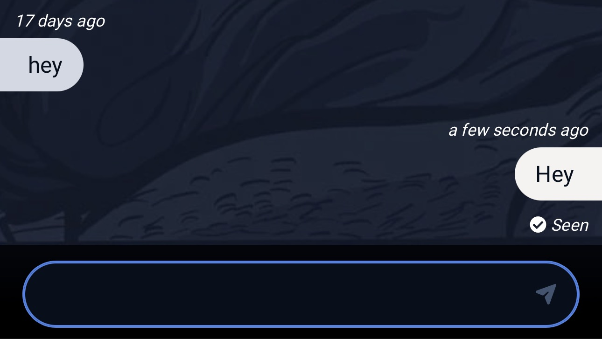
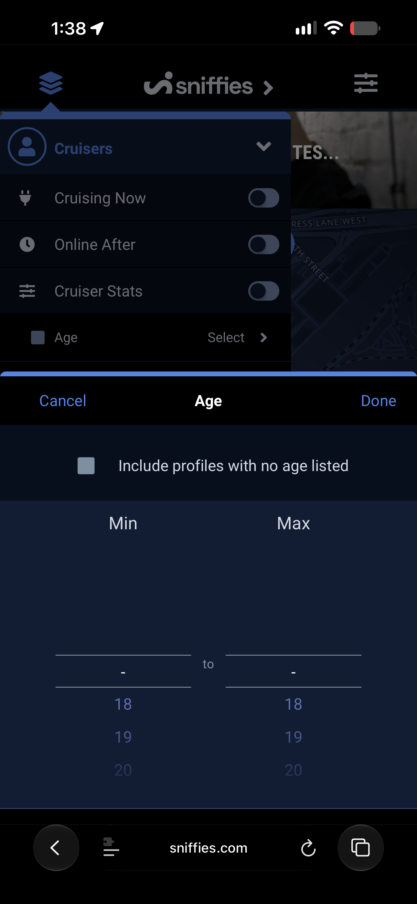

import SniffiesInstallPicker from "../../components/ui/SniffiesInstallPicker.astro";
import SniffiesPrivacyPolicy from "../../components/ui/SniffiesPrivacyPolicy.astro";

{/* ## Previous whats next:

- **Dismiss from map:** hide a profile from the map for 24 hours without blocking them.
- **Auto chat:** Grindr-style saved chat messages
- **Pinnging profiles:** Another premium feature I think I can make work through the project. */}

## What's new?

Two things this release: Read Receipts, the fourth Premium Feature, and a round of fixes and improvements to Profile Filters.

### Read Receipts

With Read Receipts on, a "Seen" marker appears under the last message you sent that the other person has read. It looks like the one Sniffies shows paid accounts, and if you have Sniffies Plus the project leaves Sniffies' own marker alone.

The marker updates when you open or reload a chat. It does not update live while the chat is open: Sniffies tells the page about new read state over a websocket, and the project only reads the message history loaded with the chat. If you're waiting on a "Seen" to show up, reload.

### Better Profile Filters

Profile Filters got the biggest rework since 0.4.

- **Include profiles with none listed:** every filter now has an "include profiles with none listed" option. Say you filter by age but a profile has no age on it. Before, that profile was always hidden. Now you choose whether it stays visible.
- **Filter replacement fixes:** several bugs in how my filters replace Sniffiess filters are fixed.
- **Metric and imperial:** height and weight filters now read the unit setting from your Sniffies settings properly.
- **Online after vs. cruising now:** turning on "Online after" now turns off "Cruising now", since the two contradict each other.

As before, filters apply to the map only. Your chats are never hidden.

## How do I use these features?

**Profile Filters:** nothing to change. Open the "Profile Filters" section as before; the "include profiles with none listed" option appears on each filter row.

**Read Receipts:** open the "Premium Features" section of the popup (Chrome extension) or panel (userscript, bookmarklet), turn on the master toggle, then switch on "Read Receipts". It is off by default.

| Feature                                                   | Chrome extension | Userscript | Bookmarklet |
| --------------------------------------------------------- | ---------------- | ---------- | ----------- |
| **Premium Features**                                      |                  |            |             |
| &nbsp;&nbsp;↳ Location spoofing                           | Yes              | Yes        | No          |
| &nbsp;&nbsp;↳ Profiles outside your free radius           | Yes              | Yes        | Yes         |
| &nbsp;&nbsp;↳ Hide / unhide sent photos                   | Yes              | Yes        | Yes         |
| &nbsp;&nbsp;↳ Read Receipts                               | Yes              | Yes        | Yes         |

## What's next?

- Carry over the "what's next?" from 0.4:
    - dismissing profiles from map
    - fake profile detection
    - auto chat options
    - reverse engineer pinning
- Talking with users, working around the block limit

<SniffiesInstallPicker version={frontmatter.version} />

<SniffiesPrivacyPolicy />
